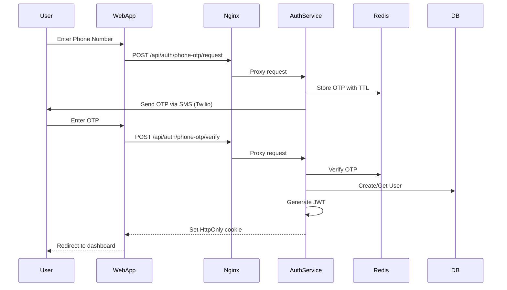
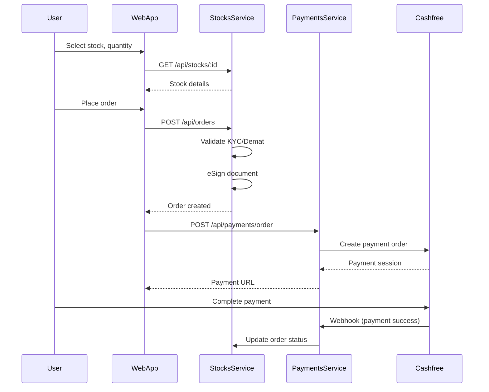
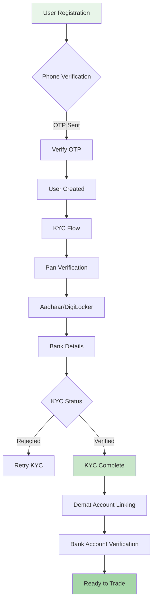
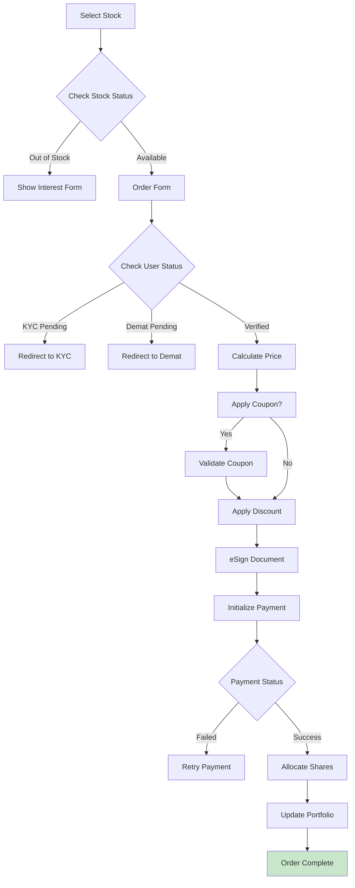
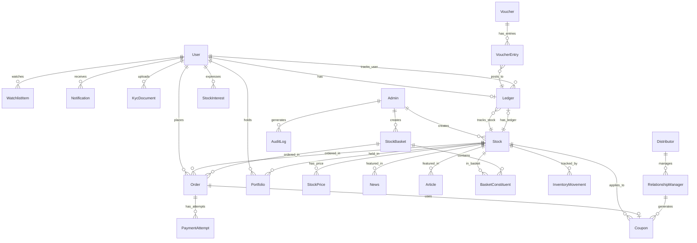

# Code Review Graph - SMC Unlisted Stox

> Auto-generated architectural documentation for code reviewers
> Last Updated: 2025-06-25

---

## Table of Contents

1. [Project Overview](#project-overview)
2. [Architecture Summary](#architecture-summary)
3. [Dependency Graph](#dependency-graph)
4. [Key Modules/Components Breakdown](#key-modulescomponents-breakdown)
5. [Critical Paths and Core Files](#critical-paths-and-core-files)
6. [Data Flow Diagrams](#data-flow-diagrams)
7. [API Gateway Routing](#api-gateway-routing)
8. [Database Schema Relationships](#database-schema-relationships)
9. [Review Checklist](#review-checklist)

---

## Project Overview

### Project Type
**Full-Stack Monorepo** - Unlisted stock trading platform built with:
- **Frontend**: Next.js 16 (React 19) - Multiple web applications
- **Backend**: NestJS microservices
- **Database**: PostgreSQL with Prisma ORM
- **Infrastructure**: Docker, Nginx, MinIO, Redis
- **Build System**: Turborepo with pnpm workspaces

### Business Domain
An online platform for trading unlisted/pre-IPO stocks featuring:
- User authentication (email/OTP, phone-first)
- KYC verification and document management
- Stock listings, baskets, and portfolios
- Order management with e-sign integration
- Payment processing (Cashfree integration)
- Multi-role admin panels (Admin, CMS, Support, Marketing, Operations, Accounting)
- Support ticketing system

### Key Technologies
| Layer | Technology |
|-------|------------|
| Package Manager | pnpm 9.0.0 |
| Build System | Turborepo 2.5.8 |
| Frontend Framework | Next.js 16.1.4 |
| UI Library | React 19.2.3 |
| Backend Framework | NestJS 11.1.8 |
| Database ORM | Prisma 6.18.0 |
| Database | PostgreSQL |
| Cache/Queue | Redis, Bull |
| Object Storage | MinIO (S3-compatible) |
| Payment Gateway | Cashfree |
| Styling | TailwindCSS 3.4 |
| State Management | Zustand |
| HTTP Client | Axios |

---

## Architecture Summary

### High-Level Architecture

```
+-----------------------------------------------------------------------------+
�                              CLIENT LAYER                                    �
+-----------------------------------------------------------------------------�
�  +-------------+  +-------------+  +-----------------+  +----------------+  �
�  �   Web App   �  � Panels App  �  � RM-Distributors �  �  Mobile/PWA    �  �
�  � (Port 3000) �  � (Port 4000) �  �   (Port 8000)   �  �   (Service     �  �
�  �  Customers  �  � Admin/CMS/  �  �  Distributors   �  �    Worker)     �  �
�  �             �  � Support/etc �  �                 �  �                �  �
�  +-------------+  +-------------+  +-----------------+  +----------------+  �
+---------+----------------+------------------+-------------------+-----------+
          �                �                  �                   �
          ?                ?                  ?                   ?
+-----------------------------------------------------------------------------+
�                           NGINX REVERSE PROXY                                �
�  - Rate limiting (auth: 10r/m, api: 100r/s)                                  �
�  - SSL termination (external)                                               �
�  - Static file serving (MinIO)                                               �
�  - API gateway routing                                                       �
+-----------------------------------------------------------------------------+
          �
          ?
+-----------------------------------------------------------------------------+
�                          MICROSERVICES LAYER                                  �
+------------------------------------------------------------------------------�
�  +---------------+ +---------------+ +---------------+ +----------------+   �
�  � Auth Service  � �Stocks Service � �Ticketing Svc  � �Payments Service�   �
�  � (Port 3002)   � � (Port 3003)   � � (Port 3001)   � � (Port 3004)    �   �
�  �               � �               � �               � �                �   �
�  � - JWT Auth    � � - Stocks      � � - Tickets     � � - Cashfree     �   �
�  � - OTP Verify  � � - Orders      � � - Labels      � � - Webhooks     �   �
�  � - Sessions    � � - Portfolio   � � - Support     � � - Transactions �   �
�  � - Admin Panel � � - KYC/Demat   � � - Assignment  � �                �   �
�  �   Auth        � � - Content     � �               � �                �   �
�  +---------------+ � - Baskets     � +---------------+ +----------------+   �
�          �         � - Accounting  �         �                  �           �
�          �         +---------------+         �                  �           �
�          �         �                        �                  �           �
�          �         �  +----------------+     �                  �           �
�          �         �  �Storage Service �     �                  �           �
�          �         �  � (Port 3005)    �     �                  �           �
�          �         �  � - MinIO Upload �     �                  �           �
�          �         �  � - S3 API       �     �                  �           �
�          �         �  +----------------+     �                  �           �
+-----------------------------------------------------------------------------�
�                            SHARED PACKAGES                                    �
+-----------------------------------------------------------------------------�
�  +-----------------+ +-----------------+ +-----------------+               �
�  � db-unlistedstock� �  db-ticketing   � �  email-service  �               �
�  � (Prisma Client) � � (Prisma Client) � � (Resend wrapper)�               �
�  +-----------------+ +-----------------+ +-----------------+               �
�  +-----------------+ +-----------------+ +-----------------+               �
�  �  redis-service  � �  cookie-crypto  � �  shared-types   �               �
�  � (IORedis wrapper� � (AES-256-GCM)   � � (TypeScript)    �               �
�  +-----------------+ +-----------------+ +-----------------+               �
�  +-----------------+ +-----------------+ +-----------------+               �
�  �     @repo/ui    � �  stats-types    � � @repo/ts-config �               �
�  � (Shared React   � � (Statistics     � � (TS Configs)    �               �
�  �  Components)    � �  Interfaces)    � �                 �               �
�  +-----------------+ +-----------------+ +-----------------+               �
+-----------------------------------------------------------------------------+
          �                                           �
          ?                                           ?
+---------------------------------+    +-------------------------------------+
�          DATABASES              �    �          INFRASTRUCTURE              �
+---------------------------------�    +--------------------------------------�
�  PostgreSQL (Main DB)           �    �  Redis (Cache/Queue/OTP Store)       �
�  - Users, Stocks, Orders        �    �  - Session management                �
�  - Portfolio, KYC, etc.         �    �  - OTP verification                   �
�                                 �    �  - Bull job queues                    �
�  PostgreSQL (Ticketing DB)      �    �                                       �
�  - Tickets, Labels, Comments    �    �  MinIO (Object Storage)               �
�                                 �    �  - KYC documents                      �
�                                 �    �  - Stock documents                    �
�                                 �    �  - Static assets                      �
+---------------------------------+    +-------------------------------------+
```

---

## Dependency Graph

### Monorepo Workspace Structure

```mermaid
graph TD
    subgraph "Applications (apps/*)"
        WEB[web<br/>Next.js 16<br/>Port 3000]
        PANELS[panels<br/>Next.js 16<br/>Port 4000]
        RM_DIST[rm-distributors<br/>Next.js 16<br/>Port 8000]
        AUTH[auth-service<br/>NestJS<br/>Port 3002]
        STOCKS[stocks-service<br/>NestJS<br/>Port 3003]
        TICKETS[ticketing-service<br/>NestJS<br/>Port 3001]
        PAYMENTS[payments-service<br/>NestJS<br/>Port 3004]
        STORAGE[storage-service<br/>NestJS<br/>Port 3005]
    end

    subgraph "Shared Packages (packages/*)"
        DB_MAIN[db-unlistedstock<br/>Prisma Client]
        DB_TICKET[db-ticketing<br/>Prisma Client]
        REDIS[redis-service<br/>IORedis]
        EMAIL[email-service<br/>Resend]
        COOKIE[cookie-crypto<br/>AES-256-GCM]
        SHARED[shared-types<br/>TypeScript]
        STATS[stats-types<br/>TypeScript]
        UI["@repo/ui<br/>React Components"]
        ESLINT["@repo/eslint-config"]
        TS_CONFIG["@repo/typescript-config"]
    end

    %% Frontend dependencies
    WEB --> UI
    WEB --> COOKIE
    WEB --> STATS
    PANELS --> UI
    PANELS --> COOKIE
    PANELS --> STATS
    RM_DIST --> COOKIE

    %% Backend dependencies
    AUTH --> DB_MAIN
    AUTH --> REDIS
    AUTH --> EMAIL
    AUTH --> COOKIE

    STOCKS --> DB_MAIN
    STOCKS --> REDIS
    STOCKS --> EMAIL
    STOCKS --> COOKIE

    TICKETS --> DB_MAIN
    TICKETS --> DB_TICKET
    TICKETS --> EMAIL
    TICKETS --> COOKIE
    TICKETS --> STATS
    TICKETS --> SHARED

    PAYMENTS --> DB_MAIN
    PAYMENTS --> EMAIL
    PAYMENTS --> COOKIE

    STORAGE --> COOKIE

    %% Package dependencies
    DB_MAIN --> TS_CONFIG
    DB_TICKET --> TS_CONFIG
    EMAIL --> TS_CONFIG

    %% Style
    classDef app fill:#e1f5fe,stroke:#01579b
    classDef pkg fill:#f3e5f5,stroke:#4a148c
    classDef db fill:#fff3e0,stroke:#e65100
    
    class WEB,PANELS,RM_DIST,AUTH,STOCKS,TICKETS,PAYMENTS,STORAGE app
    class DB_MAIN,DB_TICKET,REDIS,EMAIL,COOKIE,SHARED,STATS,UI,ESLINT,TS_CONFIG pkg
```



### Package Dependency Matrix

| Package | db-unlistedstock | db-ticketing | redis-service | email-service | cookie-crypto | shared-types | stats-types |
|---------|-------------------|--------------|---------------|---------------|---------------|--------------|-------------|
| auth-service | **X** | - | **X** | **X** | **X** | - | - |
| stocks-service | **X** | - | **X** | **X** | **X** | - | - |
| ticketing-service | **X** | **X** | - | **X** | **X** | **X** | **X** |
| payments-service | **X** | - | - | **X** | **X** | - | - |
| storage-service | - | - | - | - | **X** | - | - |
| web | - | - | - | - | **X** | - | **X** |
| panels | - | - | - | - | **X** | - | **X** |

---

## Key Modules/Components Breakdown

### 1. Frontend Applications

#### 1.1 Web App (`apps/web`)
**Purpose**: Customer-facing platform for stock trading

**Key Directories**:
```
apps/web/
+-- app/                    # Next.js App Router pages
�   +-- (main)/            # Public routes (stocks, baskets, news)
�   +-- (user)/            # Authenticated user routes (dashboard, settings)
�   +-- login/             # Authentication pages
+-- components/
�   +-- ui/                # Base UI components (Radix + Tailwind)
�   +-- stocks/            # Stock-related components
�   +-- baskets/           # Basket components
�   +-- orders/            # Order flow components
�   +-- kyc/               # KYC verification flow
�   +-- auth/              # Authentication components
�   +-- layout/            # Layout components
+-- lib/                   # API clients and utilities
�   +-- api-client.ts      # Axios configuration
�   +-- stocks-api.ts       # Stock API calls
�   +-- auth-api.ts        # Auth API calls
�   +-- [...]-api.ts       # Other API modules
+-- store/                 # Zustand state stores
�   +-- auth-store.ts      # Authentication state
+-- types/                 # TypeScript type definitions
+-- middleware.ts          # Auth middleware (protected routes)
```

**Critical Files**:
- `middleware.ts` - Route protection and auth state management
- `lib/api-client.ts` - HTTP client with SSR/CSR handling
- `app/layout.tsx` - Root layout with providers

#### 1.2 Panels App (`apps/panels`)
**Purpose**: Multi-tenant admin dashboard for different roles

**Route Groups**:
```
apps/panels/app/
+-- (admin)/               # Admin panel - user management, RM, settings
+-- (cms)/                 # CMS - stocks, articles, news, FAQs
+-- (support)/             # Support - ticket management
+-- (marketing)/           # Marketing - campaigns, leads
+-- (operation)/           # Operations - orders, stock interests
+-- (accounting)/          # Accounting - ledgers, vouchers, reports
```

**Key Features**:
- Role-based access control per panel
- Separate authentication flow per role
- Audit logging for admin actions

#### 1.3 RM-Distributors App (`apps/rm-distributors`)
**Purpose**: Dashboard for relationship managers and distributors

---

### 2. Backend Services

#### 2.1 Auth Service (`apps/auth-service`)
**Purpose**: Authentication and session management

**Modules**:
| Module | Description |
|--------|-------------|
| `auth` | JWT authentication, OTP verification, session management |
| `sms` | Twilio SMS integration for OTP delivery |
| `redis` | Redis-based OTP storage |
| `prisma` | Database access |

**Key Endpoints**:
- `POST /api/auth/phone-otp/request` - Request OTP
- `POST /api/auth/phone-otp/verify` - Verify OTP
- `GET /api/auth/profile` - Get user profile
- `POST /api/auth/admin/login` - Admin login
- `POST /api/auth/cms/login` - CMS login

#### 2.2 Stocks Service (`apps/stocks-service`)
**Purpose**: Core business logic for stock trading

**Modules**:
| Module | Description |
|--------|-------------|
| `stocks` | Stock CRUD, pricing, documents |
| `upcoming-stocks` | Pre-listing stock management |
| `orders` | Order placement and management |
| `portfolio` | User portfolio tracking |
| `baskets` | Stock basket management |
| `kyc` | KYC verification workflow |
| `demat` | Demat account linking |
| `bank` | Bank account management |
| `content` | News and articles |
| `marketing` | Marketing campaigns and leads |
| `accounting` | Double-entry bookkeeping |
| `notifications` | User notifications |
| `watchlist` | User watchlist |
| `settings` | Global admin settings |
| `audit` | Audit logging |
| `seo-metadata` | SEO management |

**Key Features**:
- Bull queues for async processing (revalidation, snapshots)
- Cron scheduling for periodic tasks
- Global JWT auth guard with `@Public()` decorator

#### 2.3 Ticketing Service (`apps/ticketing-service`)
**Purpose**: Support ticket system

**Database**: Separate PostgreSQL database (`db-ticketing`)

**Features**:
- Ticket CRUD with label management
- Agent assignment and SLA tracking
- Support ticket comments

#### 2.4 Payments Service (`apps/payments-service`)
**Purpose**: Payment processing with Cashfree

**Features**:
- Payment order creation
- Webhook handling for payment status
- Multiple payment attempts tracking

#### 2.5 Storage Service (`apps/storage-service`)
**Purpose**: File upload and storage via MinIO

**Features**:
- S3-compatible file upload
- Pre-signed URL generation
- Bucket management

---

### 3. Shared Packages

#### 3.1 Database Packages

| Package | Database | Usage |
|---------|----------|-------|
| `db-unlistedstock` | PostgreSQL (main) | Users, Stocks, Orders, Portfolio, KYC, Accounting |
| `db-ticketing` | PostgreSQL (ticketing) | Tickets, Labels, Comments |

**Key Exports**:
```typescript
// db-unlistedstock
export { PrismaClient } from './generated/prisma';
export { ADMIN_PERMISSIONS } from './constants/admin-permissions';

// db-ticketing
export { PrismaClient as TicketingPrismaClient } from './generated/prisma';
```

#### 3.2 Service Packages

| Package | Purpose |
|---------|---------|
| `redis-service` | Redis client for caching, sessions, OTP storage |
| `email-service` | NestJS module for sending emails via Resend |
| `cookie-crypto` | AES-256-GCM encryption for HTTP cookies |

#### 3.3 Type Packages

| Package | Purpose |
|---------|---------|
| `shared-types` | Common TypeScript interfaces (SupportTicketStats, KYC types) |
| `stats-types` | Statistics and analytics interfaces |

#### 3.4 UI Package

`@repo/ui` contains shared React components:
- `button.tsx` - Button component
- `card.tsx` - Card component
- `code.tsx` - Code display component

---

## Critical Paths and Core Files

### Authentication Flow



### Order Placement Flow



### Core Files to Review

#### High Priority (Authentication/Security)
| File | Risk Level | Reason |
|------|------------|--------|
| `apps/auth-service/src/auth/auth.service.ts` | **Critical** | Auth logic, token generation |
| `apps/auth-service/src/auth/guards/*.ts` | **Critical** | Route protection |
| `packages/cookie-crypto/src/index.ts` | **Critical** | Cookie encryption |
| `apps/web/middleware.ts` | **Critical** | Route protection |
| `apps/web/lib/api-client.ts` | **High** | HTTP client, token handling |
| `nginx.conf` | **High** | Rate limiting, security headers |

#### High Priority (Business Logic)
| File | Risk Level | Reason |
|------|------------|--------|
| `apps/stocks-service/src/orders/orders.service.ts` | **Critical** | Order placement, validation |
| `apps/stocks-service/src/kyc/kyc.service.ts` | **Critical** | KYC verification |
| `apps/payments-service/src/payments/payment.service.ts` | **Critical** | Payment processing |
| `packages/db-unlistedstock/prisma/schema.prisma` | **Critical** | Data model |

#### Medium Priority
| File | Risk Level | Reason |
|------|------------|--------|
| `apps/stocks-service/src/accounting/*.ts` | **Medium** | Financial calculations |
| `apps/stocks-service/src/portfolio/portfolio.service.ts` | **Medium** | User holdings |
| `apps/ticketing-service/src/tickets/*.ts` | **Medium** | Support workflow |

---

## Data Flow Diagrams

### User Registration & KYC Flow



### Stock Order Processing



---

## API Gateway Routing

### Nginx Route Configuration

| Route Pattern | Upstream Service | Notes |
|---------------|------------------|-------|
| `/api/auth/admin/*` | stocks-service | Panel auth handled by stocks-service |
| `/api/auth/cms/*` | stocks-service | Panel auth handled by stocks-service |
| `/api/auth/support/*` | stocks-service | Panel auth handled by stocks-service |
| `/api/auth/marketing/*` | stocks-service | Panel auth handled by stocks-service |
| `/api/auth/operation/*` | stocks-service | Panel auth handled by stocks-service |
| `/api/auth/*` | auth-service | User auth |
| `/api/stocks/*` | stocks-service | Stock endpoints |
| `/api/baskets/*` | stocks-service | Basket endpoints |
| `/api/content/*` | stocks-service | News/articles |
| `/api/tickets/*` | ticketing-service | Support tickets |
| `/api/labels/*` | ticketing-service | Ticket labels |
| `/api/payments/*` | payments-service | Payment processing |
| `/api/upload/*` | storage-service | File uploads |
| `/storage/*` | minio | Static file serving |
| `/*` | nextjs_frontend | Next.js app |

### Rate Limiting

| Zone | Rate | Burst | Applied To |
|------|------|-------|------------|
| `auth_limit` | 10 req/min | 5 | Auth endpoints (login, verify) |
| `api_limit` | 100 req/sec | 20 | API endpoints |

---

## Database Schema Relationships

### Core Entity Relationships



### Key Models Summary

| Model | Purpose | Critical Fields |
|-------|---------|-----------------|
| `User` | Customer accounts | `kycStatus`, `dematStatus`, `phone` |
| `Stock` | Unlisted stocks | `cin`, `isin`, `price`, `stockQuantity` |
| `Order` | Purchase orders | `status`, `paymentStatus`, `esignStatus` |
| `Portfolio` | User holdings | `quantity`, `avgPrice` |
| `Ledger` | Accounting accounts | `type`, `currentBalance` |
| `Voucher` | Financial transactions | `type`, `status`, `totalAmount` |
| `Admin` | Panel users | `role`, `permissions` |

---

## Review Checklist

### Security Review

- [ ] **Authentication**
  - [ ] JWT token expiration and refresh logic
  - [ ] OTP rate limiting (consider adding more granular limits)
  - [ ] Session management and concurrent sessions
  - [ ] Password hashing (bcrypt) verification
  
- [ ] **Authorization**
  - [ ] Role-based access control implementation
  - [ ] Permission checks in guards
  - [ ] Public route decorator usage
  
- [ ] **Data Protection**
  - [ ] Cookie encryption (AES-256-GCM) key rotation plan
  - [ ] HTTPS enforcement
  - [ ] Sensitive data masking in logs

### Performance Review

- [ ] **Database**
  - [ ] Index usage verification (check slow queries)
  - [ ] N+1 query prevention
  - [ ] Connection pool configuration
  
- [ ] **Caching**
  - [ ] Redis cache invalidation strategy
  - [ ] Nginx cache bypass for authenticated users
  
- [ ] **API**
  - [ ] SSR timeout handling (5s timeout)
  - [ ] Request payload size limits
  - [ ] Pagination implementation

### Code Quality Review

- [ ] **Error Handling**
  - [ ] Graceful degradation for service failures
  - [ ] User-friendly error messages
  - [ ] Error logging without sensitive data
  
- [ ] **Type Safety**
  - [ ] TypeScript strict mode enabled
  - [ ] Zod validation on API inputs
  - [ ] Prisma type safety
  
- [ ] **Testing**
  - [ ] E2E tests for critical paths (auth, orders)
  - [ ] Unit tests for business logic
  - [ ] Integration tests for services

### Infrastructure Review

- [ ] **Docker**
  - [ ] Container resource limits (mem_limit)
  - [ ] Health check endpoints
  - [ ] Log rotation configuration
  
- [ ] **Nginx**
  - [ ] Security headers presence
  - [ ] Rate limiting configuration
  - [ ] SSL/TLS configuration (external)
  
- [ ] **Database**
  - [ ] Migration management
  - [ ] Backup strategy
  - [ ] Connection string security

---

## Appendix: File Statistics

### Project Size Overview

| Category | Count |
|----------|-------|
| Total TypeScript Files | ~200+ |
| Frontend Apps | 3 |
| Backend Services | 5 |
| Shared Packages | 10 |
| Database Models | 40+ |
| API Endpoints | 100+ |
| React Components | 100+ |

### Largest Files by LOC

| File | Purpose |
|------|---------|
| `packages/db-unlistedstock/prisma/schema.prisma` | Database schema (1400+ lines) |
| `apps/web/lib/api-client.ts` | HTTP client (230+ lines) |
| `nginx.conf` | Reverse proxy config (320+ lines) |
| `apps/web/next.config.js` | Next.js config (340+ lines) |

---

*Generated for code review purposes. Update this document when significant architectural changes occur.*
