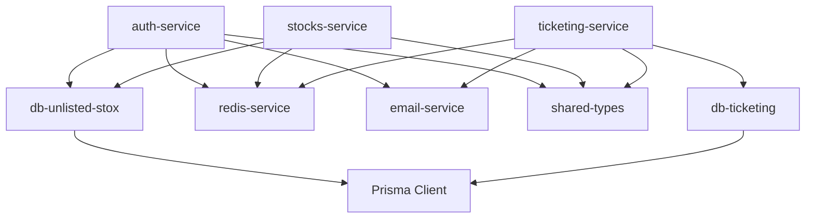

# Monorepo Docker Guide

## Introduction

### Challenges of Building Monorepo Applications in Docker
Building monorepo applications in Docker presents unique challenges that standard single-repository Docker builds don't encounter. The primary issue is workspace dependency resolution - when packages within the monorepo reference each other using protocols like `workspace:*`, Docker's layer caching and build context limitations can cause builds to fail or become inefficient.

### Why Standard Docker Builds Fail with Workspace Dependencies
Traditional Docker builds copy the entire project directory into the build context, but workspace dependencies like `"@smc/db-unlisted-stox": "workspace:*"` don't resolve to actual file paths during the build process. This leads to:
- Build failures when Docker tries to install dependencies
- Inefficient layer caching due to changing workspace references
- Difficulty in optimizing build contexts

### Overview of the Solution: pnpm deploy Command
The solution implemented in this monorepo uses `pnpm deploy` to resolve workspace dependencies before the production build. This command creates a standalone directory with all dependencies resolved to their actual file paths, eliminating workspace protocol references.

## Monorepo Structure Overview

### Workspace Packages
The monorepo contains several shared packages that services depend on:

- **`packages/db-unlisted-stox`**: Prisma schema and client for the main application database
- **`packages/db-ticketing`**: Prisma schema and client for the support ticketing database
- **`packages/redis-service`**: Redis connection and caching utilities
- **`packages/email-service`**: Email sending utilities using SendGrid
- **`packages/shared-types`**: TypeScript type definitions shared across services

### Service Applications
Three NestJS microservices that depend on the workspace packages:

- **`apps/auth-service`**: Authentication and user management
- **`apps/stocks-service`**: Stock market data and trading functionality
- **`apps/ticketing-service`**: Customer support ticketing system

### Dependency Graph


## Understanding Workspace Dependencies

### How Workspace Dependencies Work
In `package.json`, dependencies can reference other packages in the monorepo using the `workspace:` protocol:

```json
{
  "dependencies": {
    "@smc/db-unlisted-stox": "workspace:*",
    "@smc/redis-service": "workspace:*"
  }
}
```

This tells pnpm to resolve the dependency from within the monorepo workspace rather than from the npm registry.

### Example from auth-service/package.json
```json
{
  "name": "@smc/auth-service",
  "dependencies": {
    "@smc/db-unlisted-stox": "workspace:*",
    "@smc/redis-service": "workspace:*",
    "@smc/email-service": "workspace:*",
    "@smc/shared-types": "workspace:*"
  }
}
```

### Why These Dependencies Need Special Handling in Docker
Docker builds run in isolation and don't have access to the full monorepo context. When Docker encounters `workspace:*` references during `pnpm install`, it fails because it can't resolve these references to actual packages.

## Multi-Stage Docker Build Process

### Stage 1: Builder

#### Copying Workspace Configuration Files
The builder stage starts by copying essential workspace configuration files:

```dockerfile
FROM node:18-alpine AS builder

# Install pnpm
RUN npm install -g pnpm@9.0.0

# Copy workspace configuration
COPY pnpm-lock.yaml package.json pnpm-workspace.yaml turbo.json ./

# Copy package directories
COPY packages/db-unlisted-stox/package.json packages/db-unlisted-stox/
COPY packages/db-ticketing/package.json packages/db-ticketing/
COPY packages/redis-service/package.json packages/redis-service/
COPY packages/email-service/package.json packages/email-service/
COPY packages/shared-types/package.json packages/shared-types/

# Copy service package.json
COPY apps/auth-service/package.json apps/auth-service/
```

#### Installing Dependencies with Frozen Lockfile
```dockerfile
# Install all dependencies
RUN pnpm install --frozen-lockfile
```

#### Copying Required Packages and Service Code
```dockerfile
# Copy package source code
COPY packages/db-unlisted-stox packages/db-unlisted-stox/
COPY packages/db-ticketing packages/db-ticketing/
COPY packages/redis-service packages/redis-service/
COPY packages/email-service packages/email-service/
COPY packages/shared-types packages/shared-types/

# Copy service source code
COPY apps/auth-service apps/auth-service/
```

#### Prisma Client Generation
```dockerfile
# Generate Prisma clients (must happen before building)
RUN cd packages/db-unlisted-stox && npx prisma generate
RUN cd packages/db-ticketing && npx prisma generate
```

#### Building Packages in Dependency Order
```dockerfile
# Build packages first (in dependency order)
RUN pnpm --filter @smc/shared-types build
RUN pnpm --filter @smc/db-unlisted-stox build
RUN pnpm --filter @smc/db-ticketing build
RUN pnpm --filter @smc/redis-service build
RUN pnpm --filter @smc/email-service build
```

#### Building the Service Application
```dockerfile
# Build the service application
RUN pnpm --filter @smc/auth-service build
```

### Stage 2: pnpm deploy

#### Detailed Explanation of pnpm deploy
The `pnpm deploy` command creates a production-ready directory structure by:

1. Resolving all `workspace:*` dependencies to their actual built packages
2. Including only production dependencies (excluding devDependencies)
3. Creating a flattened directory structure without workspace symlinks

#### Command Syntax
```dockerfile
RUN pnpm deploy --filter=@smc/auth-service --prod /app/deploy
```

- `--filter=@smc/auth-service`: Selects the auth-service and its dependencies
- `--prod`: Excludes devDependencies
- `/app/deploy`: Output directory for the deployed application

#### What Gets Included
- Production dependencies resolved to actual packages
- Built TypeScript code from all dependent packages
- Prisma client code and migrations
- Service application built code

#### What Gets Excluded
- Dev dependencies (testing frameworks, build tools)
- Source TypeScript files (only compiled JavaScript)
- Test files and documentation
- Development configuration files

#### Directory Structure After pnpm deploy
```
/app/deploy/
├── node_modules/          # Resolved production dependencies
├── packages/
│   ├── db-unlisted-stox/  # Built package with actual files
│   ├── redis-service/     # Built package with actual files
│   └── ...                # Other resolved packages
├── dist/                  # Compiled service application
├── package.json           # Service package.json with resolved deps
└── prisma/               # Database schema and migrations
```

### Stage 3: Production

#### Creating Minimal Runtime Image
```dockerfile
FROM node:18-alpine AS production

# Install dumb-init for proper signal handling
RUN apk add --no-cache dumb-init

# Create non-root user
RUN addgroup -g 1001 -S nodejs
RUN adduser -S nestjs -u 1001

# Copy deployed application
COPY --from=builder /app/deploy /app

# Set correct ownership
RUN chown -R nestjs:nodejs /app
USER nestjs

# Set memory limit
ENV NODE_OPTIONS="--max-old-space-size=200"

# Expose port
EXPOSE 3000

# Health check
HEALTHCHECK --interval=30s --timeout=3s --start-period=5s --retries=3 \
  CMD node --version || exit 1

# Start application
ENTRYPOINT ["dumb-init", "--"]
CMD ["node", "dist/main.js"]
```

#### Key Production Optimizations
- **Alpine Linux**: Minimal base image (~5MB)
- **dumb-init**: Proper signal handling for container orchestration
- **Non-root user**: Security best practice
- **Memory limits**: Prevents OOM issues on constrained instances
- **Health checks**: Enables Docker orchestration monitoring

## Layer Caching Optimization

### Order of COPY Commands
The order of COPY commands is crucial for Docker layer caching:

```dockerfile
# Copy dependency files first (changes infrequently)
COPY pnpm-lock.yaml package.json ./

# Copy package.json files (changes when dependencies change)
COPY packages/*/package.json packages/

# Install dependencies (cached if above files don't change)
RUN pnpm install --frozen-lockfile

# Copy source code last (changes frequently)
COPY packages/ packages/
COPY apps/auth-service apps/auth-service/
```

### When to Use --no-cache Flag
Use `--no-cache` when:
- Debugging build issues
- Dependencies have changed unexpectedly
- Base images need updating
- After clearing local Docker cache

### Minimizing Build Context with .dockerignore
```
# Exclude unnecessary files from build context
node_modules/
.git/
.vscode/
*.log
.env*
docs/
README.md
```

## Debugging Workspace Resolution Issues

### Common Errors and Solutions

**Error: "Cannot resolve workspace dependency"**
```
Solution: Ensure all dependent packages are built before the service
Check: Build order in Dockerfile respects dependency graph
```

**Error: "Module not found" after pnpm deploy**
```
Solution: Verify package.json includes all necessary dependencies
Check: pnpm deploy output directory structure
```

**Error: "Prisma client not found"**
```
Solution: Run prisma generate before building dependent packages
Check: Prisma schema files are copied correctly
```

### Inspecting the Deployed Directory Structure
```bash
# During build, inspect the deployed directory
RUN ls -la /app/deploy/
RUN ls -la /app/deploy/packages/
RUN cat /app/deploy/package.json
```

### Verifying Prisma Client Generation
```bash
# Check if Prisma clients were generated
RUN ls -la packages/db-unlisted-stox/generated/
RUN ls -la packages/db-ticketing/generated/
```

### Checking package.json After pnpm deploy
The deployed `package.json` should have resolved workspace dependencies:

```json
{
  "dependencies": {
    "@smc/db-unlisted-stox": "file:../packages/db-unlisted-stox",
    "@smc/redis-service": "file:../packages/redis-service"
  }
}
```

## Building Images Locally

### Using build-docker-images.sh for Local Testing
The repository includes a script for building Docker images locally:

```bash
# Build specific service
./scripts/build-docker-images.sh --service auth-service

# Build all services
./scripts/build-docker-images.sh --all
```

### Verifying Built Images
```bash
# List built images
docker images | grep smc

# Check image size and layers
docker history smc-auth-service:latest

# Inspect image contents
docker run --rm -it smc-auth-service:latest sh
ls -la /app/
```

### Testing Images Locally
```bash
# Run image with environment variables
docker run -p 3000:3000 \
  -e DATABASE_URL="postgresql://..." \
  -e REDIS_URL="redis://..." \
  smc-auth-service:latest

# Test health endpoint
curl http://localhost:3000/health
```

## Comparison with Other Approaches

### Why Not Use npm or yarn Workspaces
- **npm/yarn**: Don't have `deploy` command for production builds
- **Manual copying**: Error-prone and hard to maintain
- **Symlinks**: Don't work in Docker containers

### Why Not Copy Entire Monorepo into Docker Image
- **Security**: Exposes source code and development files
- **Size**: Includes unnecessary files (tests, docs, node_modules)
- **Complexity**: Harder to optimize and debug

### Why Not Use Separate Repositories for Each Service
- **Coordination**: Difficult to coordinate changes across services
- **Duplication**: Shared code gets duplicated or becomes out of sync
- **Versioning**: Complex version management between services

### Trade-offs and Benefits
**Benefits:**
- ✅ Single source of truth for shared code
- ✅ Atomic changes across services
- ✅ Efficient Docker builds with proper caching
- ✅ Type safety across service boundaries

**Trade-offs:**
- ❌ Complex Docker build process
- ❌ All services rebuild when shared packages change
- ❌ Larger build context and longer build times

## Best Practices

### Keep Dockerfiles Consistent Across Services
All service Dockerfiles follow the same pattern:
- Identical builder stage structure
- Same production optimizations
- Consistent environment variables

### Use Specific pnpm Version for Reproducibility
```dockerfile
RUN npm install -g pnpm@9.0.0
```
- Ensures consistent behavior across builds
- Prevents breaking changes from pnpm updates

### Always Generate Prisma Clients Before Building
```dockerfile
RUN cd packages/db-unlisted-stox && npx prisma generate
RUN cd packages/db-ticketing && npx prisma generate
```
- Required for TypeScript compilation
- Must happen before dependent packages are built

### Set Appropriate Memory Limits for Production
```dockerfile
ENV NODE_OPTIONS="--max-old-space-size=200"
```
- Prevents memory exhaustion on t2.micro instances
- Balances performance with resource constraints

### Use Multi-Stage Builds to Minimize Image Size
- Builder stage: Full development environment
- Production stage: Minimal runtime environment
- Result: ~50MB production images vs ~500MB+ with single stage