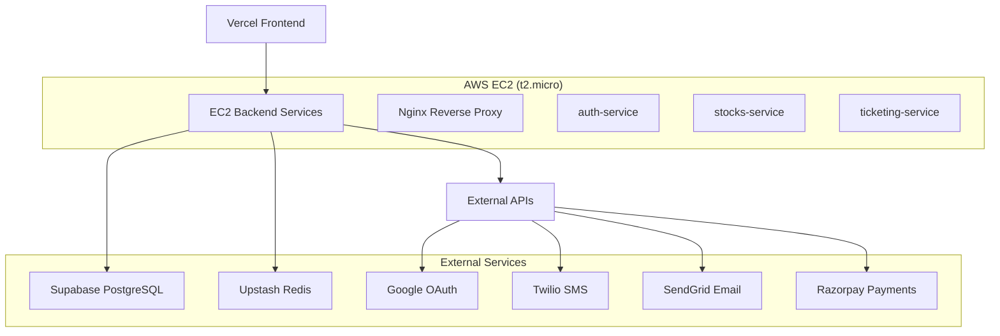

# Staging Deployment Guide

## Backend Deployment Status

The authoritative backend staging deployment flow has moved to [BACKEND_CICD_V1.md](BACKEND_CICD_V1.md).

Use that document for:

- GitHub Actions backend CI
- `staging` deployment approvals
- GHCR image usage
- EC2 rollout behavior
- backend rollback expectations
- migration safety policy boundaries

The rest of this document remains useful as historical setup/reference material for the staging environment, but it is not the authoritative backend deployment procedure anymore.

## Introduction

### Overview of the Staging Architecture
The SMC Unlisted Stox staging environment consists of a hybrid cloud architecture combining AWS EC2 for backend services, Vercel for frontend deployment, Supabase for databases, and Upstash for Redis caching. This setup provides cost-effective staging deployment while maintaining production-like reliability and security.

### Architecture Diagram


### Prerequisites Checklist
- [ ] AWS account with billing enabled and credit card verified
- [ ] GitHub repository access with push permissions
- [ ] Google Cloud Console access for OAuth setup
- [ ] Twilio account for SMS functionality
- [ ] SendGrid account for email services
- [ ] Razorpay account for payment processing
- [ ] Basic knowledge of SSH, Docker, and Linux commands

**Estimated Time Requirements:**
- Infrastructure Setup: 2-3 hours
- Service Configuration: 1-2 hours
- EC2 Setup: 30 minutes
- Database Migrations: 15 minutes
- Backend Deployment: 20 minutes
- Frontend Deployment: 30 minutes
- Verification: 30 minutes

**Total Estimated Time: 6-8 hours**

### Cost Breakdown
- **AWS EC2 (t2.micro)**: Free for 12 months, then ~₹500/month
- **Supabase**: Free tier (500MB database, 50MB file storage)
- **Upstash Redis**: Free tier (10,000 requests/day)
- **Vercel**: Free tier (100GB bandwidth, 100 deployments/month)
- **External APIs**: Free/test tiers available
- **Total Monthly Cost**: ₹0 for 6-12 months using free tiers

## Phase 1: Infrastructure Setup

### AWS Account Setup and EC2 Instance Creation
Follow the detailed instructions in [AWS_EC2_SETUP.md](AWS_EC2_SETUP.md) to create and configure your EC2 instance.

### Supabase Project Creation
1. Visit [supabase.com](https://supabase.com) and create a new account
2. Create a new project with the following settings:
   - **Project Name**: `smc-unlisted-stox-staging`
   - **Database Password**: Generate a strong password
   - **Region**: Select the closest region to your users
3. Wait for project initialization (5-10 minutes)
4. Navigate to Settings > API to get your project URL and anon key

### Upstash Redis Setup
1. Visit [upstash.com](https://upstash.com) and create an account
2. Create a new Redis database:
   - **Name**: `smc-staging-redis`
   - **Region**: Select the same region as your Supabase project
3. Enable TLS encryption in the database settings
4. Copy the Redis URL and password from the connection details

### Security Group Configuration
Configure your EC2 security group to allow:
- **SSH (Port 22)**: From your IP address only
- **HTTP (Port 80)**: From anywhere (0.0.0.0/0)

## Phase 2: Service Configuration

### Environment Variables Setup
Reference [ENVIRONMENT_SETUP.md](ENVIRONMENT_SETUP.md) for complete environment variable documentation.

1. Copy `.env.staging.example` to `.env.staging`
2. Fill in the following variables:

**Database Configuration:**
```
DATABASE_URL=postgresql://postgres:[PASSWORD]@[HOST]:5432/postgres
ADMIN_DATABASE_URL=postgresql://postgres:[ADMIN_PASSWORD]@[HOST]:5432/postgres
TICKETING_DATABASE_URL=postgresql://postgres:[TICKETING_PASSWORD]@[HOST]:5432/postgres
```

**Redis Configuration:**
```
REDIS_HOST=your-redis-host.upstash.io
REDIS_PORT=6379
REDIS_PASSWORD=your-redis-password
REDIS_TLS=true
```

**External Service Configuration:**
```
GOOGLE_CLIENT_ID=your_google_client_id
GOOGLE_CLIENT_SECRET=your_google_client_secret
TWILIO_ACCOUNT_SID=your_twilio_account_sid
SENDGRID_API_KEY=your_sendgrid_api_key
RAZORPAY_KEY_ID=your_razorpay_key_id
RAZORPAY_KEY_SECRET=your_razorpay_key_secret
```

### Google OAuth Setup
1. Go to [Google Cloud Console](https://console.cloud.google.com)
2. Create a new project or select existing one
3. Enable Google+ API
4. Create OAuth 2.0 credentials
5. Add authorized origins: `http://YOUR_EC2_IP`
6. Add redirect URIs: `http://YOUR_EC2_IP/api/auth/google/callback`

### Twilio SMS Configuration
1. Create a Twilio account at [twilio.com](https://twilio.com)
2. Get your Account SID and Auth Token from the dashboard
3. Purchase a phone number for SMS sending
4. Configure the phone number in your environment variables

### SendGrid Email Setup
1. Create a SendGrid account at [sendgrid.com](https://sendgrid.com)
2. Create an API key with full access
3. Verify your sender email address
4. Configure DNS records if using custom domain

### Razorpay Payment Gateway
1. Create a Razorpay account at [razorpay.com](https://razorpay.com)
2. Enable test mode
3. Get your Key ID and Key Secret
4. Configure webhook endpoints for payment callbacks

## Phase 3: EC2 Initial Setup

### Automated Setup with Script
Use the automated setup script to configure your EC2 instance:

```bash
./scripts/setup-ec2.sh --ip YOUR_EC2_IP --key ~/.ssh/your-key.pem
```

**What the script installs:**
- Docker (latest version)
- Docker Compose (latest version)
- Git (for repository cloning)
- Firewall configuration
- System updates and security patches

### Manual Verification Steps
After script completion, verify the installation:

```bash
# SSH into your EC2 instance
ssh -i ~/.ssh/your-key.pem ec2-user@YOUR_EC2_IP

# Verify Docker installation
docker --version
docker-compose --version

# Test Docker functionality
docker run hello-world

# Check available disk space
df -h
```

### Repository Setup
```bash
# Clone the repository
git clone <REPOSITORY_URL> ~/smc-unlisted-stox

# Navigate to the project directory
cd ~/smc-unlisted-stox

# Copy environment file
scp -i ~/.ssh/your-key.pem .env.staging ec2-user@YOUR_EC2_IP:~/smc-unlisted-stox/
```

## Phase 4: Database Migrations

### Running Database Migrations
Use the migration script to set up your databases. This script runs locally from the repository root and requires the `.env.staging` file to be populated with database connection details.

```bash
# Ensure you're in the repository root
cd ~/smc-unlisted-stox

# Run database migrations (requires .env.staging to be configured)
./scripts/migrate-staging.sh
```

**Note:** The migration script runs locally and connects directly to your Supabase databases using the connection strings in `.env.staging`. It does not support remote execution via SSH.

### Migration Verification
After migration completion, verify the databases:

```bash
# SSH into EC2 and check migration status
ssh -i ~/.ssh/your-key.pem ec2-user@YOUR_EC2_IP

# Check if Prisma clients are generated
ls -la packages/db-unlisted-stox/generated/
ls -la packages/db-ticketing/generated/

# Test database connectivity (from EC2)
docker run --rm -it --network host postgres:15 psql "postgresql://postgres:PASSWORD@db:5432/postgres" -c "SELECT version();"
```

### Troubleshooting Database Issues
- **Connection refused**: Check Supabase IP allowlist includes your EC2 IP
- **Migration failures**: Verify DATABASE_URL format and credentials
- **Prisma client errors**: Ensure migrations ran successfully before deployment

## Phase 5: Backend Deployment

### Automated Deployment
Deploy all backend services using the deployment script:

```bash
./scripts/deploy-to-ec2.sh --ip YOUR_EC2_IP --key ~/.ssh/your-key.pem
```

**What happens during deployment:**
1. Pull latest code from repository
2. Build Docker images for all services
3. Stop existing containers
4. Start new containers with updated images
5. Run health checks

### Monitoring Deployment Progress
```bash
# Monitor deployment logs in real-time
ssh -i ~/.ssh/your-key.pem ec2-user@YOUR_EC2_IP
cd ~/smc-unlisted-stox

# Check Docker container status
docker-compose -f docker-compose.staging.yml ps

# View service logs
docker-compose -f docker-compose.staging.yml logs -f auth-service
docker-compose -f docker-compose.staging.yml logs -f stocks-service
docker-compose -f docker-compose.staging.yml logs -f ticketing-service
```

### Health Check Verification
Test all API endpoints after deployment:

```bash
# Test individual services directly (from EC2)
curl http://localhost:3002/api/health  # Auth service
curl http://localhost:3003/api/health  # Stocks service
curl http://localhost:3001/api/health  # Ticketing service

# Test Nginx reverse proxy health check
curl http://localhost/health  # Nginx health endpoint

# Test external access via public IP
curl http://YOUR_EC2_IP/health  # Public health check
```

## Phase 6: Frontend Deployment

### Vercel Setup
Follow the complete Vercel deployment guide in [VERCEL_DEPLOYMENT.md](VERCEL_DEPLOYMENT.md).

### Key Configuration Steps
1. Connect your GitHub repository to Vercel
2. Configure the following environment variables in Vercel dashboard:
   - `NEXT_PUBLIC_AUTH_SERVICE_URL`: `http://YOUR_EC2_IP`
   - `NEXT_PUBLIC_STOCKS_SERVICE_URL`: `http://YOUR_EC2_IP`
   - `NEXT_PUBLIC_TICKETING_SERVICE_URL`: `http://YOUR_EC2_IP`
   - `NEXT_PUBLIC_APP_URL`: `https://your-vercel-domain.vercel.app`
   - Other `NEXT_PUBLIC_*` variables as needed

### Testing Integration
After deployment, test the complete flow:
1. Access your Vercel frontend URL
2. Attempt user registration/login
3. Verify API calls reach your EC2 backend
4. Check browser network tab for CORS issues

## Phase 7: Post-Deployment Verification

### Comprehensive Verification Checklist
- [ ] EC2 instance is running and accessible via SSH
- [ ] Docker containers are running: `docker-compose -f docker-compose.staging.yml ps`
- [ ] All services respond to health checks
- [ ] Nginx reverse proxy routes correctly
- [ ] Database connections work from all services
- [ ] Redis cache is accessible
- [ ] Google OAuth login flow works
- [ ] SMS OTP functionality works
- [ ] Email notifications are sent
- [ ] Payment processing works (test mode)
- [ ] Vercel frontend loads correctly
- [ ] API calls from frontend reach backend
- [ ] No CORS errors in browser console
- [ ] Memory usage is under 1GB total
- [ ] All environment variables are set correctly
- [ ] SSL certificates are valid (if configured)

### Authentication Flow Testing
1. Navigate to your Vercel frontend
2. Click "Sign in with Google"
3. Complete OAuth flow
4. Verify user data is stored in database
5. Test OTP SMS functionality
6. Verify JWT tokens are generated correctly

### API Connectivity Testing
```bash
# Test from local machine
curl -H "Origin: https://your-vercel-domain.vercel.app" \
     http://YOUR_EC2_IP/api/auth/health

# Check CORS headers in response
curl -I -H "Origin: https://your-vercel-domain.vercel.app" \
       http://YOUR_EC2_IP/api/auth/health
```

### Docker Health Monitoring
```bash
# Check container resource usage
docker stats

# Monitor logs for errors
docker-compose -f docker-compose.staging.yml logs --tail=100 -f

# Verify container health checks
docker ps --format "table {{.Names}}\t{{.Status}}\t{{.Ports}}"
```

## Troubleshooting

### Common Deployment Issues

**Docker Build Failures**
- **Workspace dependency errors**: Ensure `pnpm deploy` runs correctly in Dockerfiles
- **Solution**: Check [MONOREPO_DOCKER_GUIDE.md](MONOREPO_DOCKER_GUIDE.md) for workspace resolution

**Database Connection Errors**
- **Supabase IP allowlist**: Add your EC2 IP to Supabase project settings
- **Connection string format**: Verify DATABASE_URL syntax
- **Migration order**: Run migrations before deploying services

**Redis Connection Errors**
- **TLS configuration**: Ensure REDIS_URL uses `rediss://` protocol
- **Upstash firewall**: Add EC2 IP to Upstash database allowlist

**Nginx Routing Issues**
- **CORS headers**: Check Nginx configuration for proper CORS setup
- **Proxy headers**: Verify X-Forwarded-* headers are passed correctly
- **Service ports**: Ensure services bind to correct internal ports

**Memory Issues**
- **OOM killer**: Monitor with `docker stats` and `dmesg | grep -i oom`
- **Container limits**: Check Docker Compose memory limits
- **Swap configuration**: Ensure swap space is configured on EC2

**Service Startup Failures**
- **Health check timeouts**: Increase timeout values in docker-compose.yml
- **Dependency order**: Ensure databases start before services
- **Environment variables**: Verify all required env vars are set

### Log Locations and Access
```bash
# Docker container logs
docker-compose -f docker-compose.staging.yml logs SERVICE_NAME

# Nginx access logs
tail -f /var/log/nginx/access.log

# Nginx error logs
tail -f /var/log/nginx/error.log

# Application logs (inside containers)
docker-compose -f docker-compose.staging.yml exec SERVICE_NAME tail -f /app/logs/app.log
```

### Using Docker Compose for Debugging
```bash
# View all logs
docker-compose -f docker-compose.staging.yml logs -f

# View specific service logs
docker-compose -f docker-compose.staging.yml logs -f auth-service

# Restart specific service
docker-compose -f docker-compose.staging.yml restart auth-service

# Rebuild specific service
docker-compose -f docker-compose.staging.yml build auth-service
docker-compose -f docker-compose.staging.yml up -d auth-service
```

## Rollback Procedures

### Docker Image Rollback
```bash
# List available images
docker images

# Rollback to specific image tag
docker-compose -f docker-compose.staging.yml pull  # Pull latest images
docker-compose -f docker-compose.staging.yml up -d --no-build  # Use existing images

# Or specify exact image version
docker-compose -f docker-compose.staging.yml up -d --scale auth-service=0
docker-compose -f docker-compose.staging.yml up -d auth-service
```

### Git-Based Rollback
```bash
# On your local machine
git log --oneline -10  # Find previous commit
git revert HEAD~1  # Revert last commit
git push origin main

# Then redeploy
./scripts/deploy-to-ec2.sh --ip YOUR_EC2_IP --key ~/.ssh/your-key.pem
```

### Database Rollback Considerations
- **Prisma migrations**: Use `npx prisma migrate reset` for development only
- **Production data**: Never rollback migrations that affect production data
- **Backup strategy**: Implement regular database backups before deployments

## Monitoring and Maintenance

### Daily Health Checks
```bash
# Run health checks without rebuilding
./scripts/deploy-to-ec2.sh --ip YOUR_EC2_IP --key ~/.ssh/your-key.pem --skip-build
```

### Resource Monitoring
```bash
# Monitor Docker containers
docker stats

# Check system resources
htop  # or top

# Monitor disk usage
df -h

# Check memory usage
free -h
```

### Log Management
- Docker automatically rotates logs with json-file driver
- Nginx logs rotate via logrotate (configured in setup script)
- Application logs should implement log rotation

### AWS Cost Monitoring
- Monitor EC2 usage in AWS Billing dashboard
- Set up billing alerts for unexpected charges
- Track free tier usage expiration dates

## Reference Links

### Documentation Files
- [ENVIRONMENT_SETUP.md](ENVIRONMENT_SETUP.md) - Environment configuration
- [VERCEL_DEPLOYMENT.md](VERCEL_DEPLOYMENT.md) - Frontend deployment
- [MONOREPO_DOCKER_GUIDE.md](MONOREPO_DOCKER_GUIDE.md) - Docker build technical details
- [AWS_EC2_SETUP.md](AWS_EC2_SETUP.md) - EC2 infrastructure setup

### Deployment Scripts
- [scripts/setup-ec2.sh](../scripts/setup-ec2.sh) - EC2 initial setup
- [scripts/deploy-to-ec2.sh](../scripts/deploy-to-ec2.sh) - Backend deployment
- [scripts/migrate-staging.sh](../scripts/migrate-staging.sh) - Database migrations
- [scripts/build-docker-images.sh](../scripts/build-docker-images.sh) - Local Docker builds

### External Services
- [AWS EC2 Console](https://console.aws.amazon.com/ec2/) - Instance management
- [Supabase Dashboard](https://supabase.com/dashboard) - Database management
- [Upstash Console](https://console.upstash.com) - Redis management
- [Vercel Dashboard](https://vercel.com/dashboard) - Frontend deployment
- [Google Cloud Console](https://console.cloud.google.com) - OAuth configuration
- [Twilio Console](https://console.twilio.com) - SMS configuration
- [SendGrid Dashboard](https://app.sendgrid.com) - Email configuration
- [Razorpay Dashboard](https://dashboard.razorpay.com) - Payment configuration